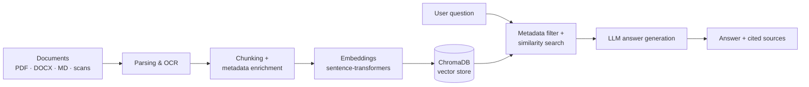

<div align="center">

# 📚 SmartDocs-RAG

### Metadata-aware Retrieval-Augmented Generation for intelligent document search and source-grounded question answering

[](https://www.python.org/)
[](https://fastapi.tiangolo.com/)
[](https://streamlit.io/)
[](https://www.langchain.com/)
[](https://www.trychroma.com/)
[](https://www.docker.com/)

</div>

---

## ✨ Overview

**SmartDocs-RAG** lets you upload your own documents and ask questions about them in natural language. Instead of relying only on vector similarity, it attaches **metadata** to every chunk, so retrieval can be **filtered** (by document, type, source, and more) before the LLM generates an answer. Every answer is **grounded in the retrieved sources**, so you can see where the information came from.

It ships as a complete, deployable system: a **FastAPI** backend, a **Streamlit** interface, a persistent **ChromaDB** vector store, and a **Docker** image with OCR support.

## 🎯 Key Features

| | Feature | Details |
|---|---|---|
| 🔎 | **Metadata-aware retrieval** | Chunks carry metadata, enabling filtered search instead of blind top-k similarity |
| 🧾 | **Source-grounded answers** | Responses are generated from retrieved context so they can be traced back to documents |
| 📄 | **Multi-format ingestion** | PDF, Word (`.docx`), Markdown, and other formats through `unstructured` |
| 👁️ | **OCR for scanned documents** | Tesseract + Poppler, with **English and Persian** language packs included |
| 🧠 | **Local embeddings** | Hugging Face `sentence-transformers` models; no embedding API required |
| 🗄️ | **Persistent vector store** | ChromaDB index stored on a mounted volume, so it survives restarts |
| 🌐 | **REST API + Web UI** | FastAPI service with a health endpoint, plus a Streamlit front end |
| 🐳 | **Production-minded Docker image** | Non-root user, healthcheck, CPU-only PyTorch by default, optional GPU build |

## 🏗️ How It Works



1. **Ingest**: documents are parsed (with OCR fallback for scanned pages) and split into chunks.
2. **Enrich**: each chunk is stored with metadata describing where it came from.
3. **Embed & index**: chunks are embedded with a Hugging Face model and stored in ChromaDB.
4. **Retrieve**: a question is combined with optional metadata filters to fetch the most relevant chunks.
5. **Generate**: the LLM answers using only the retrieved context and returns the supporting sources.

## 🧰 Tech Stack

- **Language:** Python 3.11
- **RAG framework:** LangChain (`langchain`, `langchain-community`, `langchain-text-splitters`)
- **Embeddings:** Hugging Face via `langchain-huggingface` and `sentence-transformers`
- **Vector database:** ChromaDB (`langchain-chroma`, `chromadb`)
- **Document processing:** PyMuPDF, pdfminer.six, `unstructured`, `python-docx`, `docx2txt`, Markdown
- **OCR:** Tesseract (`pytesseract`), `pdf2image`, Pillow
- **Backend:** FastAPI + Uvicorn, Pydantic v2
- **Frontend:** Streamlit
- **Deployment:** Docker

## 🚀 Getting Started

### Option 1: Docker (recommended)

```bash
git clone https://github.com/HosseinHeydari2004/SmartDocs-RAG.git
cd SmartDocs-RAG

# Build (CPU-only PyTorch by default, smaller image)
docker build -t smartdocs-rag .

# Run the API (port 8000); /data persists the vector index and model cache
docker run -p 8000:8000 -v smartdocs-data:/data smartdocs-rag
```

Run the Streamlit UI from the same image:

```bash
docker run -p 8501:8501 -v smartdocs-data:/data \
  -e SMARTDOCS_API_URL=http://host.docker.internal:8000 \
  smartdocs-rag streamlit run ui/app.py --server.address 0.0.0.0 --server.port 8501
```

**GPU build:**

```bash
docker build --build-arg TORCH_INDEX=https://download.pytorch.org/whl/cu121 -t smartdocs-rag:gpu .
```

### Option 2: Local setup

Requires Python 3.11, [Tesseract](https://github.com/tesseract-ocr/tesseract) (with the `eng` and `fas` language data) and [Poppler](https://poppler.freedesktop.org/) for OCR.

```bash
git clone https://github.com/HosseinHeydari2004/SmartDocs-RAG.git
cd SmartDocs-RAG

python -m venv .venv
source .venv/bin/activate        # Windows: .venv\Scripts\activate
pip install -r requirements.txt

# Start the API
uvicorn src.api.main:app --host 0.0.0.0 --port 8000

# In a second terminal, start the UI
streamlit run ui/app.py
```

Then open:

- **Web UI:** http://localhost:8501
- **API docs (Swagger):** http://localhost:8000/docs
- **Health check:** http://localhost:8000/health

## ⚙️ Configuration

| Variable | Default (Docker) | Description |
|---|---|---|
| `VECTORDB_PATH` | `/data/vectordb` | Where the ChromaDB index is stored |
| `HF_HOME` | `/data/hf` | Hugging Face model cache |
| `SMARTDOCS_API_URL` | `http://localhost:8000` | API address used by the Streamlit UI |

Settings can also be provided through a `.env` file (loaded with `python-dotenv`).

> **Note:** the API runs with a **single worker** by design, because job state and the session API key are held in process memory.

## 🗂️ Project Structure

```
SmartDocs-RAG/
├── src/                # Application code (API, ingestion, retrieval)
│   └── api/main.py     # FastAPI entry point
├── ui/                 # Streamlit interface
├── Dockerfile          # Production-style image (non-root, healthcheck)
├── requirements.txt    # Python dependencies
└── README.md
```

## 🤝 Contributing

Issues and pull requests are welcome. For larger changes, please open an issue first to discuss what you would like to change.

## 👤 Author

**Hossein Heydari**, Computer Engineering student, Co-Founder & Technical Lead at [AI Builders Iran](https://github.com/AI-Builders-Iran), an open-source organization building production-grade Computer Vision, LLM, RAG, and AI Agent systems.

- 💼 LinkedIn: [hossein-heydari2004](https://www.linkedin.com/in/hossein-heydari2004)
- 🐙 GitHub: [@HosseinHeydari2004](https://github.com/HosseinHeydari2004)
- ✉️ Email: hosseinheydari982020@gmail.com

---

<div align="center">

⭐ If you find this project useful, consider giving it a star!

</div>
